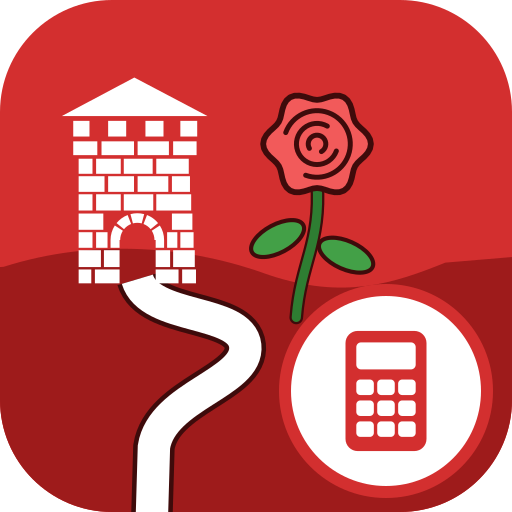

<p align="center"></p>
<h1 align="center">Rosenweg Rechner</h1>
<p align="center">Taschenrechner für die Smartphones der Siedlung Rosenweg – auf den geteilten Telefonen und dem eigenen Handy.</p>
<p align="center"><a href="https://www.rosenweg4303.ch/apps">Herunterladen</a> · <a href="docs/anleitung.md">Anleitung</a></p>

## Inhalt

- [Überblick](#überblick)
- [Plattformen](#plattformen)
- [Rechte und Gruppen](#rechte-und-gruppen)
- [Bedienung](#bedienung)
- [Geteilte Rosenweg-Telefone](#geteilte-rosenweg-telefone)
- [Rosenweg Updater](#rosenweg-updater)
- [Aufbau](#aufbau)
- [Bauen](#bauen)
- [Logo](#logo)
- [CI und Release](#ci-und-release)
- [Konfiguration](#konfiguration)
- [Zweige](#zweige)
- [Herkunft und Lizenz](#herkunft-und-lizenz)

## Überblick

Taschenrechner für die Smartphones der Siedlung Rosenweg in Kaiseraugst. Funktional ist es der Rechner von Fossify; angepasst sind Name, Paketname, das Rosenweg-Logo und das Verhalten auf den geteilten Rosenweg-Telefonen. Spenden-, Store- und Rückmeldekanäle des Originals sind entfernt.

Was die App kann:

- **Rechnen:** Grundrechenarten, Prozent, Wurzel und Potenzen, mit Verlauf.
- **Einheiten umrechnen:** Umrechner für Länge, Gewicht, Temperatur und mehr.
- **Einstellungen pro Person:** auf geteilten Telefonen gehören sie der angemeldeten Person und sind an jedem geteilten Telefon wieder da.
- **Rosenweg Updater:** hält auf dem eigenen Handy alle Rosenweg-Apps aktuell.
- **Ohne Ablenkung:** Spenden-, Store- und Rückmeldekanäle des Originals sind entfernt.

## Plattformen

| Plattform | Stand |
|---|---|
| Android, eigenes Handy | ja, APK auf [rosenweg4303.ch/apps](https://www.rosenweg4303.ch/apps); danach aktualisiert der Rosenweg Updater |
| Geteilte Rosenweg-Telefone | ja, Rosenweg Gerät installiert sie aus dem App-Katalog der Telefonanlage und hält sie aktuell |
| Play Store, F-Droid | nein – die App ist mit dem Rosenweg-Schlüssel signiert; Fassungen anderer Herkunft lassen sich nicht darüber installieren |

## Rechte und Gruppen

Die App hat keine eigenen Rollen.

| Wer | sieht und darf |
|---|---|
| Angemeldete Person (geteiltes Telefon) | eigene Einstellungen, gespeichert über Rosenweg Gerät |
| Eigenes Handy | alles wie im Original, Einstellungen auf dem Handy |
| Technik | legt den Katalog-Eintrag `ch.rosenweg4303.math` auf rosenweg4303.ch/smartphones an und bestimmt dort, für welche Gruppen die App auf den geteilten Telefonen erscheint |

## Bedienung

| Was | So geht’s |
|---|---|
| Rechnen | Zahlen und Rechenzeichen tippen, `=` zeigt das Ergebnis; frühere Rechnungen im Verlauf |
| Einheiten umrechnen | Umrechner im Menü öffnen, Grösse und Einheiten wählen |
| Einstellungen | Menü → Einstellungen. Auf geteilten Telefonen speichert sie Rosenweg Gerät für die angemeldete Person auf der Telefonanlage; ohne Rosenweg Gerät bleiben sie auf dem Handy. |

Ausführlich: [docs/anleitung.md](docs/anleitung.md).

## Geteilte Rosenweg-Telefone

Auf den geteilten Telefonen (Anmeldung per Karte am Sperrbildschirm) übernimmt **Rosenweg Gerät**:

| Was | Wie |
|---|---|
| Installation und Updates | automatisch aus dem App-Katalog der Telefonanlage |
| Einstellungen | gehören der angemeldeten Person, liegen auf der Telefonanlage und sind nach dem Anmelden an jedem geteilten Telefon wieder da |
| Voraussetzung | Rosenweg-Signatur: Rosenweg Gerät gibt Daten nur an Apps mit seiner Signatur weiter (`ch.rosenweg4303.permission.ANLAGE`) |

## Rosenweg Updater

Auf Handys ohne Rosenweg Gerät prüft die App den App-Katalog der Telefonanlage und bietet Aktualisierungen für alle installierten Rosenweg-Apps an. Jede APK wird vorher geprüft (Prüfsumme, Paketname, Version, Rosenweg-Signatur); Android lässt jede Installation bestätigen. Auf geteilten Telefonen übernimmt das Rosenweg Gerät.

## Aufbau

| Teil | Inhalt |
|---|---|
| Grundlage | [Fossify Calculator](https://github.com/FossifyOrg/Calculator), Kotlin; Kotlin-Namensraum wie im Original, nur die applicationId ist eigen |
| Paketname | `ch.rosenweg4303.math` (in `gradle.properties` als `APP_ID`), aktuelle Version 1.4.0 |
| [commons-rosenweg](https://github.com/Rosenweg/commons-rosenweg) | Rosenweg-Fork der Fossify Commons, Version `7.1.3-rosenweg.1` (`gradle/libs.versions.toml`) |
| Rosenweg-Modul | `ch.rosenweg4303:updater` 0.1.2 aus commons-rosenweg (Rosenweg Updater) |
| `helpers/AnlageEinstellungen.kt` | Einstellungen pro Person über Rosenweg Gerät (`AnlageProvider`, Berechtigung `ch.rosenweg4303.permission.ANLAGE`) |
| `assets/logo/` | Logo aus dem Baukasten von rosenweg-basis (siehe [Logo](#logo)) |

Kotlin-Pfade relativ zu `app/src/main/kotlin/org/fossify/math/`.

## Bauen

Die App baut gegen commons-rosenweg und die Rosenweg-Module (`ch.rosenweg4303:*`) aus dem lokalen Maven-Repository (`mavenLocal()`). Also zuerst commons-rosenweg veröffentlichen:

```bash
# in commons-rosenweg, Zweig rosenweg
./gradlew -PVERSION=7.1.3-rosenweg.1 publishToMavenLocal

# in diesem Repo, Zweig main
./gradlew assembleFossRelease
```

| Was | Wo |
|---|---|
| APK | `app/build/outputs/apk/foss/release/` |
| Signatur | `keystore.properties` (Vorlage `keystore.properties_sample`); Datei und Schlüssel liegen nicht im Repo |
| Version | `VERSION_NAME`, `VERSION_CODE` in `gradle.properties` |

Mehr: [docs/entwickeln.md](docs/entwickeln.md).

## Logo

Rosenweg-Wappen (Turm, Weg, Rose auf Rot) mit dem Zeichen der App rechts unten, erzeugt mit dem Logo-Baukasten aus rosenweg-basis; dazu ein monochromes Designsymbol (Android 13+). Die wählbaren Symbolfarben von Fossify gibt es nicht mehr: alle zeigen dasselbe Rosenweg-Symbol.

Neu erzeugen (aus dem Repo-Wurzelverzeichnis, rosenweg-basis daneben): `sh assets/logo/erzeugen.sh`. Welches Zeichen die App trägt, steht in rosenweg-basis `werkzeug/logo/android-apps.txt`.

## CI und Release

Die APK wird lokal mit dem Rosenweg-Schlüssel gebaut und als GitHub-Release veröffentlicht:

```bash
gh release create v<versionName> <datei.apk> --notes "Was ist neu"
```

| Auslöser | Ergebnis |
|---|---|
| Release veröffentlicht (Tag = versionName, eine APK je Release) | `.github/workflows/apps.yml` schickt die APK an **[rosenweg4303.ch/apps](https://www.rosenweg4303.ch/apps)** und in den App-Katalog der Telefonanlage – damit bekommen sie die geteilten Telefone und der Rosenweg Updater |
| `gh workflow run apps.yml --ref <tag>` | erneut senden, z.B. nach einer Störung |

`apps.yml` nutzt den wiederverwendbaren Workflow `apps-release.yml` aus Rosenweg/Website. Anmeldung per GitHub-OIDC, kein gespeichertes Geheimnis; die Anlage prüft Tag, Prüfsumme, Rosenweg-Signatur und Paketnamen. Der Workflow liegt im Standardzweig `main`; `gh release create` ohne `--target` setzt den Tag dort hin. Die App muss auf rosenweg4303.ch/smartphones schon im Katalog stehen.

Die übrigen Workflows (`pr.yml`, `release.yml`, `testing-build.yml`, `update-commons.yml` …) stammen aus dem Original und rufen Fossify-Workflows auf; für Rosenweg-Releases zählt nur `apps.yml`.

## Konfiguration

Keine GitHub-Secrets nötig (OIDC). Lokal, nur die Namen:

| Datei | Schlüssel | Wozu |
|---|---|---|
| `keystore.properties` | `storeFile`, `storePassword`, `keyAlias`, `keyPassword` | Rosenweg-Signierschlüssel für den Release-Bau |
| `gradle.properties` | `APP_ID`, `VERSION_NAME`, `VERSION_CODE` | Paketname und Version |

## Zweige

`main` enthält den ganzen Rosenweg-Stand; die Anpassungen wurden im Zweig `rosenweg` entwickelt und sind in `main` zusammengeführt. Gebaut und veröffentlicht wird aus `main`.

## Herkunft und Lizenz

Basiert auf [Fossify Calculator](https://github.com/FossifyOrg/Calculator) – herzlichen Dank an das Fossify-Team und alle Mitwirkenden für die solide Grundlage. Spenden-, Store- und Rückmeldekanäle des Originals sind entfernt.

Lizenz: GNU General Public License v3.0 (GPL-3.0), siehe [LICENSE](LICENSE).
